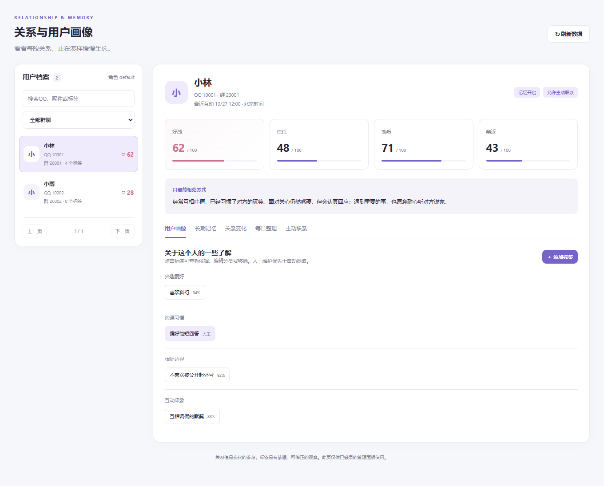

# 关系成长与记忆 · AstrBot 插件

在QQ群里正常聊天，让同一个角色与不同用户逐渐形成不同的相处方式。

保留 AstrBot 已配置的基础人设，以好感、信任、熟悉、亲近四个独立维度、相处描述和真实共同经历影响回复。支持长期记忆、每日整理，以及有动机的概率主动 @。

当前版本：**v0.2.5**（2026-10-30）。针对 **AstrBot 4.29.1 + OneBot v11（aiocqhttp，如 NapCat）+ 内置 Agent** 编写。不支持QQ官方接口的主动消息，也未适配 Dify、Coze 等第三方回复执行器。

最近更新（v0.2.5）：主动联系记录会说明这次机会为什么没有发出内容——概率未中显示当时的概率，其他情况写明具体原因，不再统一显示“本次没有发送消息正文”。

本文件只说明怎么装、怎么用。所有版本的新增功能、缺陷修复与升级影响统一记在[更新记录](CHANGELOG.md)，设计与行为约定见 `docs/DESIGN.md`。

项目仓库：[tsukikosama/astrbot-galageme](https://github.com/tsukikosama/astrbot-galageme)。

## 安装与首次配置

1. 在 AstrBot WebUI 的插件页面选择“从文件安装”，上传本插件 ZIP。也可将整个插件目录放入 `AstrBot/data/plugins/astrbot_plugin_relationship_memory/` 后重载。
2. 打开插件配置，在 **启用的QQ群号 `enabled_groups`** 中加入要使用的群号，例如 `123456789`。**空列表表示不启用任何群。**
3. 确认 AstrBot 已设置基础人设、对话模型和该群的唤醒方式。插件不会让所有群消息自动触发回复。
4. 保存配置并重载插件。在启用群里 @机器人，正常聊天即可。

无需额外 API Key 或第三方 Python 包。辅助分析默认使用当前群已选的模型，也可以在配置中选择其他提供商 ID。

也可以在插件管理中使用仓库地址安装：`https://github.com/tsukikosama/astrbot-galageme`。源码开发时建议指定插件目录名：

```bash
git clone https://github.com/tsukikosama/astrbot-galageme.git astrbot_plugin_relationship_memory
```

初次试用可先关闭“允许概率主动@”，完成几轮对话和记忆检查后再开启。插件启用后不会凭空生成共同经历，新用户也不会立刻收到随机问候。

## 扩展功能：关系与用户画像

安装或升级后重载插件，在 AstrBot WebUI 左侧的 **扩展功能 → 关系与用户画像** 打开管理页。如果侧栏按插件分组，入口位于“关系成长与记忆”分组内；也可以从插件详情中的可视化视图进入。

页面包含：

- 用户列表：按群筛选，搜索QQ号、最近昵称或标签，支持分页；好感数值下方显示当前等级名称。
- 关系详情：显示好感、信任、熟悉、亲近四项数值，每项附等级标签（如 Lv.3 熟悉）与该档位的相处描述，以及当前相处描述。
- 用户画像：分类查看兴趣爱好、生活偏好、沟通习惯、相处边界和互动印象。
- 标签维护：添加、编辑分类与公开性、移除；点击自动标签可以查看置信度、依据及来源编号。
- 长期记忆、关系变化、每日摘要和主动联系记录：各自独立栏目查看。

管理页使用 AstrBot 原生插件视图及登录鉴权，不需要额外启动服务或填写独立密码。非公开记忆只在已登录的管理详情中展示；列表不返回系统人设或完整记忆正文。

界面预览（演示数据）：



[查看窄屏布局预览](docs/images/dashboard-mobile.png)。

### 标签如何生成和生效

标签由有效聊天和每日整理增量提取，自动标签置信度至少0.8，并附有依据；每次最多6项，每用户最多30项。标签是可修正的了解，不是固定角色路线或对用户性格的定论。

人工维护优先于自动提取。移除标签后保存不含原文的同名抑制标记，防止模型在下一轮自动加回来；仍可由管理员手动重新添加。

新增人工标签默认仅管理页可见。勾选“允许在群聊回复中参考”后，才作为该用户的背景信息提供给回复模型。标签不会改写机器人的初始人设。旧档案的昵称在下一次聊天时刷新，标签会随后续互动和整理逐渐形成。

如果页面打开期间发生新聊天或其他管理操作，保存标签时可能提示数据版本已变化。关闭编辑框，刷新档案后再操作即可，避免旧页面覆盖新数据。

### 升级与兼容

在插件页面使用新版 ZIP 更新同名插件即可保留插件数据，随后重载插件并刷新 WebUI。SQLite 会自动迁移，已有关系档案、记忆和个人设定都会保留，无需手工转换数据；升级前可按下文方式备份数据目录。

每个版本新增了什么、行为有什么变化、是否会影响已有数据，见[更新记录](CHANGELOG.md)。

## 已实现的功能

### 关系成长与不同相处方式

- 以角色档案、平台实例、机器人账号、群号、用户QQ号隔离数据。
- 每个用户单独保存人设偏好、称呼和口吻；A、B都可以要求被叫“主人”，个人约定中的“唯一”不限制其他用户。本人可通过聊天修改自己的旧设定。
- 当前用户最近12轮互动以注明来源的历史参考提供，旧助手台词不再作为必须延续的当前助手立场回放；原始记录保留。插件在其他插件注入前保存核心请求、注入后恢复。Iris等插件后来追加的共享记忆、画像和提示不参与这些回复；群聊自动背景也被排除，避免个人设定经共享上下文传播。当前消息原始图片、音频和引用仍可用于理解本条消息。
- 个人设定有独立字段，需当前用户明确表达且有原文证据；随成功发送的回复保存，暂停记忆时不新增、不读取，遗忘和关系重置会清除。管理详情展示该用户的独立人设。可随时重新说“以后叫我主人，说话温柔一点”明确设置。
- 初始好感20、信任10、熟悉0、亲近0，范围均为0～100。
- 四个维度共用一套六档等级：陌生（0～24）、认识（25～39）、熟悉（40～54）、朋友（55～69）、亲密（70～84）、羁绊（85～100）。等级只是数值区间的展示标签，不是任务、称号或解锁条件，也不影响帮助质量。
- 每轮每维最多变化±3；当日累计按配置的上限执行，默认增加最多8、降低最多10，可在配置中改为任意非负整数，填 0 表示不限制；熟悉通常不下降。
- 普通问答可以不变，明确关系事件才推动发展；分析置信度低于0.7时不改分。
- 同一消息只结算一次，1小时内完全相同的内容不重复改分。
- 相处描述依据经历更新，保留原始人设，不预设固定攻略或恋爱路线。
- 短期情绪在6小时后不再注入，普通互动不会无限延长同一种情绪。
- 用户可查询自己的好感度：在启用群里 @机器人 发送“查看好感度”即可收到当前数值、对应等级（如 Lv.3 熟悉）和一句相处描述。只读取本人档案，不调用模型、不改数值、不计为一次聊天、不影响主动联系冷却和群额度；关闭数字展示时只给等级名称和相处描述。关闭开关后这句话按普通聊天处理。

每轮并行发起两项辅助分析：一项判断关系和记忆，一项仅看当前用户原文与自己的已保存设定，提取长期偏好和本轮意图。意图提取不读取旧助手回复或旧相处印象；两项分别校验置信度与原文证据，任一失败独立降级，再让 AstrBot 正常生成回复。因此每轮比只做关系判断多一次辅助模型调用。

### 记忆与每日整理

- 对稳定偏好、明确事实、共同事件和关系转折提取记忆。
- 只把适合在群里公开复述的记忆用于长期检索和主动消息。
- 保留来源消息ID或整理批次的对话ID；相同正文去重。
- 用户明确更新事实时可替代旧记忆，整理不应把过去状态覆盖到当前状态。
- 北京时间凌晨3点后开始整理前一日及更早的未处理互动；离线后自动补跑。
- 每小时按批次继续整理，单用户每批最多10轮，单次最多20个用户。聊天较多时会逐步处理，不保证3点整一次完成。
- 每日摘要分日期、分批次保存到数据库，不只保留最新一天。
- 默认原始互动保留30天；长期记忆和每日摘要保留至主动删除。

### 主动互动

主动联系以两种动机开始：用户明确提到的待跟进事件，以及熟悉后围绕共同记忆的低频重新联系。

- 默认15分钟检查一次，同一个事件机会只抽一次。
- 基础概率0.10，结合角色主动倾向、亲近程度和未回应次数调整；最终不超过0.8。
- 对事件的概率抽取没有命中时，不在每次检查时反复抽取。
- 只有熟悉度达到15、3～30天没互动且有公开记忆时，才产生一般问候候选；每3天一个机会。
- 每群每日最多3条、每用户每日最多1次，同用户冷却12小时，同群至少间隔60分钟。
- 北京时间23:00～09:00不主动发送。
- 发送前检查用户和机器人仍在群内、机器人未被禁言，并再次核对偏好和数据版本。
- 使用真正的QQ @组件，不是“@昵称”的普通文本。
- 用户没回应不扣分、不连续追问；后续主动概率降低。
- 发送结果未知时保留额度且不盲目重发；重启后未完成发送任务同样视为未知。
- 主动消息本身不加好感，用户后续回应再进入普通互动流程。

事件跟进是概率互动，**不等于准时提醒**。本版不提供准点提醒任务。

## 自然语言操作

这些操作在原本能唤醒机器人的对话中生效；必要时先 @机器人。

| 用户说 | 实际行为 |
|---|---|
| 以后别记我的聊天 | 停止新增长期记忆，同时暂停主动联系；关系数值仍可变化 |
| 恢复记忆 | 恢复新增记忆，不自动恢复主动联系 |
| 别主动@我 / 不要主动找我 / 最近别打扰我 | 停止主动联系，直到用户恢复 |
| 可以主动找我了 | 恢复主动联系，仍受群级限制 |
| 查看好感度 / 我的好感度 / 好感度多少 | 直接返回你在当前群、当前角色下的好感度、对应等级和一句相处描述；只读取，不改变数值、不计为一次聊天 |
| 你记得我什么 | 展示最多10条适合在群里公开的本人记忆 |
| 忘掉面试 | 按字面关键词“面试”删除匹配的长期记忆 |
| 清空我的记忆 | 清空本人在当前群、当前角色下的全部插件记忆；关系数值保留 |

删除时还会清理该用户在本插件中的原始互动、每日摘要、相处描述和待跟进事件，避免重新整理回来。全量遗忘同时移除全部标签；按关键词遗忘会保守清理自动标签及匹配的人工标签。必要的消息去重标记、关系数值、不含正文的额度记录及标签抑制摘要保留。

“刚才是开玩笑的”“这件事别在群里提”这类指代不明的话会要求提供具体关键词；本版不自动猜测要操作的对象。称呼和偏好的普通更新由独立的意图分析提取，属于模型判断，可在管理详情核对。一次请求只影响当轮，不自动变为永久设定。

上述记忆管理范围仅为本插件。AstrBot 自身的会话历史、其他插件及外部模型服务中的记录不属于此删除操作；若要清除主会话历史，需同时使用 AstrBot 自身的会话管理功能。插件不管理外部备份。

## 管理员操作

仅 AstrBot 管理员身份可以执行，作用于当前启用群；QQ群管理员身份不自动等同于 AstrBot 管理员。

```text
/关系管理 查看 123456789
/关系管理 暂停 123456789
/关系管理 恢复 123456789
/关系管理 清空记忆 123456789
/关系管理 重置关系 123456789
```

“查看”显示关系数值、记忆/联系开关及最近变更原因，因此请在合适场合使用。“清空记忆”保留数值；“重置关系”重置数值和相处描述，保留事实偏好等记忆。

## 主要配置

| 配置键 | 默认值 | 说明 |
|---|---|---|
| enabled_groups | 空列表 | 需要明确填写启用群 |
| role_id | default | 同一角色保持不变；换值会使用另一份档案 |
| analysis_provider_id | 空 | 默认当前群模型 |
| summary_provider_id | 空 | 默认沿用关系分析模型 |
| model_timeout | 30秒 | 辅助请求超时 |
| summary_hour | 3 | 北京时间每日整理时点 |
| retention_days | 30 | 原始互动保留时间 |
| history_turns | 12 | 机器人看到的连续对话轮数，取自本人记录；填 0 则不回放历史 |
| affection_query_enabled | true | 允许用户 @机器人 发送“查看好感度”查询本人数值；关闭后按普通聊天处理 |
| affection_query_scope | affection | 查询展示的维度：affection 只显示好感；all 同时显示好感、信任、熟悉、亲近 |
| affection_query_show_number | true | 是否展示具体数字；关闭后只回复等级名称和自然语言相处描述 |
| daily_affection_gain | 8 | 每用户每日好感度最多增加多少；填 0 为不限制 |
| daily_affection_loss | 10 | 每用户每日好感度最多下降多少；填 0 为不限制 |
| daily_dimension_gain | 8 | 每用户每日信任/熟悉/亲近最多增加多少；填 0 为不限制 |
| daily_dimension_loss | 10 | 每用户每日信任/熟悉/亲近最多下降多少；填 0 为不限制 |
| proactive_enabled | true | 群白名单生效后允许概率主动联系 |
| base_probability | 0.10 | 每个有效机会的基础概率 |
| initiative | 1.0 | 角色主动倾向，内向角色可调低 |
| check_minutes | 15 | 候选检查周期，最低5分钟 |
| group_daily_limit | 3 | 每群每日主动上限 |
| user_daily_limit | 1 | 每用户每日主动上限 |
| cooldown_hours | 12 | 同用户冷却 |
| quiet_start / quiet_end | 23 / 9 | 北京时间安静窗口；相同值表示关闭此窗口 |

初值、关系阈值、上下文截断和单轮改分限制在本版是代码常量；数值等级分档同样是常量，每日改分上限已可按上面四项配置。其余可配置项以 `_conf_schema.json` 为准。辅助请求最多并发2个，模型调用与每日整理会产生额外使用量。

## 数据保存与更新

数据位置：`AstrBot/data/plugin_data/astrbot_plugin_relationship_memory/relationships.sqlite3`，启用WAL模式。具体基础目录由 AstrBot 的数据目录接口确定。

源码与数据分开保存。重载、重启和更新源码不会主动清空数据库。需要备份时先停用插件，再备份数据目录，以便完整保存SQLite数据。

本插件的 SQLite 支持一个正在运行的插件实例。不要让多个 AstrBot 实例共用同一个数据库文件。

## 4.29.1 适配说明与当前边界

- 4.29.1 的流式回复路径不会触发普通发送完成钩子。本插件在已唤醒的关系对话开始前关闭该轮流式输出，使用普通回复流程发送；其他群不受影响。这意味着这些对话会等待生成完成再显示。
- 结算要求有完整 Agent 结果与发送完成记录。使用了完全接管发送的插件、特殊分段/工具回复或自定义执行器时，需要额外联调。平台发送完成也不代表用户已经阅读。
- 原始人设来自当轮模型请求的系统背景。改变基础人设后，下次该用户聊天会刷新快照；后台主动消息在此之前使用上次快照。更换人设期间可先暂停主动联系。
- 检索使用有限候选的关键词和中文二元词重叠，不是向量语义检索。
- 辅助模型的语气判断、事实提取、公开性分类和人物表现并非确定性规则。关系限幅、权限、隔离、冷却和预算由代码强制执行。
- 暂不包含旁听全群话题、跨群合并、单次变更撤销、精确计时提醒和复杂多角色切换。管理页目前支持查看关系与记忆、维护标签，关系数值仍由互动规则更新。

## 开发验证

在插件目录执行：

```bash
python -m unittest discover -s tests -v
```

测试覆盖 SQLite 核心、策略校验，以及使用 AstrBot 4.29.1 接口替身的插件流程。接口替身用于离线验证；另外已在服务器使用实际配置的模型和真实请求接口复现并验证个人意图流程，详情见 TEST_REPORT.md。模型测试未向真实QQ群发送消息。

首次实机验证建议检查：正常回复仍保留人设、不同用户记忆独立、主动联系关闭立即生效、重载后数据仍在，以及当前其他插件是否接管发送流程。

## 开发参考

- https://docs.astrbot.app/dev/star/plugin-new.html
- https://docs.astrbot.app/dev/star/guides/listen-message-event.html
- https://docs.astrbot.app/dev/star/guides/ai.html
- https://github.com/AstrBotDevs/AstrBot/tree/v4.29.1

插件元数据已配置作者与仓库地址。许可证尚未指定，提交插件市场前请由项目所有者确定。

用户列表与分类标签管理的交互设计参考了 [Iris 聊天陪伴记忆](https://github.com/leafliber/astrbot_plugin_iris_chat_memory)。本版沿用现有的SQLite关系与记忆结构，界面通过AstrBot原生Plugin View集成。
